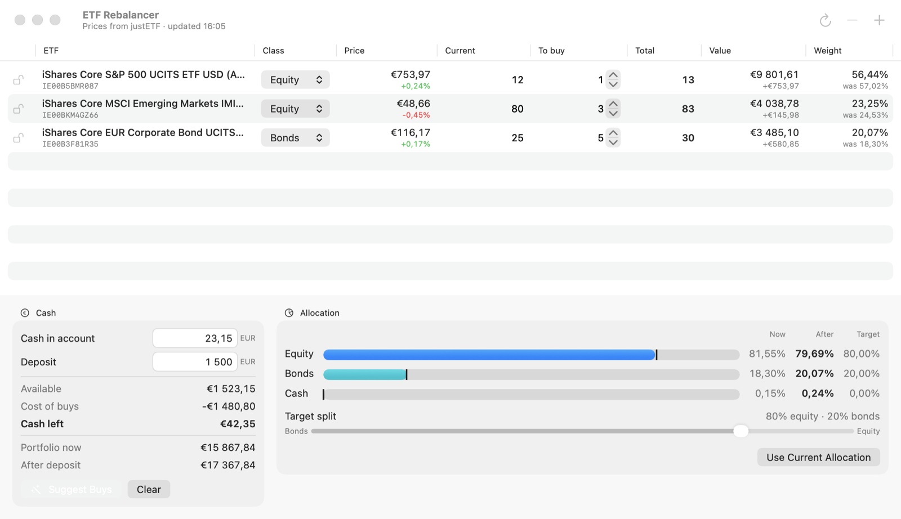

# ETF Rebalancer

A small macOS app that works out what to buy with a deposit to bring an ETF portfolio back to its target equity/bonds split. Prices come from justETF by ISIN and refresh every 5 minutes (⌘R to refresh now).



## Install

Download the zip from the latest [release](../../releases/latest), unzip it and move `ETF Rebalancer.app` to `/Applications`.

The app isn't notarized, so macOS blocks it the first time. Either allow it in System Settings › Privacy & Security › "Open Anyway", or run:

```sh
xattr -dr com.apple.quarantine "/Applications/ETF Rebalancer.app"
```

## How it works

- Each ETF has a share count and a class (equity or bonds). The only target is the equity/bonds split, set with the slider. The cash target is 0.
- "Suggest Buys" fills "To buy" with whole shares, without selling, to bring equity and bonds closest to the split. ETFs in the same class are treated as interchangeable.
- A locked ETF (padlock) still counts toward the split, but Suggest Buys never buys it and leaves its "To buy" as you set it.
- "To buy" can also be edited by hand. Every number updates as you type.

Data is saved to `~/Library/Application Support/ETF Rebalancer/portfolio.json`.

## Build

Requires macOS 14+ and Xcode (Swift 6).

```sh
swift test
./scripts/build-app.sh            # builds build/ETF Rebalancer.app (universal)
./scripts/build-app.sh --install  # also copies it to /Applications
```

## Release

Versions are git tags (`v1.2.3`). The build stamps the latest tag into the app, and the commit count as its build number.

```sh
./scripts/release.sh 1.2.3
```

From a clean `main`, this runs the tests, builds the app, zips it, tags and pushes `v1.2.3`, and creates a GitHub release with the zip attached.

## Disclaimer

Prices come from justETF's public website, which has no official API and may change without notice. This project isn't affiliated with justETF, and nothing it shows is financial advice.

MIT licensed. See [LICENSE](LICENSE).
